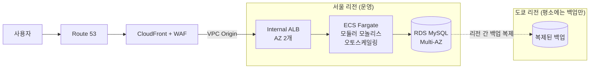

# hotel-booking-aws-v2

소규모 숙박 예약 회사의 IDC(온프레미스) 서비스를 AWS로 이관하는 프로젝트입니다.

4인 팀 프로젝트 [Project_TEAM_AWS](https://github.com/yubin05/Project_TEAM_AWS)(이하 v1)를 회고하고, 같은 고객 문제를 **고객 규모에 맞는 설계**로 다시 풀어 **실측으로 검증**하는 것이 목표입니다.

> **현재 상태: 0단계 진행 중 (백엔드 완료, 프론트·CI 남음).** 아래 "진행 상태" 표에 측정값이 기록된 항목만 "검증했다"고 표기합니다.

## 왜 v2인가

v1은 AWS–Azure 멀티클라우드 DR, 마이크로서비스 5개, DMS 실시간 복제처럼 많은 기술을 적용했습니다. 돌아보니 다음과 같은 문제가 있었습니다.

- 고객의 실제 문제는 **트래픽 폭증으로 인한 다운**(오토스케일링이 답인 문제)이었는데, 설계는 DR에 집중했습니다.
- 소규모 회사가 감당하기 어려운 **상시 비용과 운영 복잡도**가 생겼습니다.
- 장애 복구와 RTO·RPO를 **정량적으로 검증하지 못했습니다.**

v2는 **요구사항 → 설계 → 실측** 순서로 진행합니다. 자세한 내용은 [v1 회고](docs/05-v1-retrospective.md)에 있습니다.

## 시나리오 요약

Sponge Trip은 IDC에서 웹–API–DB 3계층으로 숙박 예약 서비스를 운영하던 소규모 회사입니다. 여행 유튜버의 소개 영상으로 트래픽이 몰리면서 서비스가 약 4시간 중단됐고, MSP인 우리에게 AWS 이관을 의뢰했습니다.
→ [시나리오와 요구사항](docs/01-scenario.md)

## 목표 아키텍처



| 대비하는 상황 | 방법 |
|---|---|
| 트래픽 폭증 | CloudFront 캐시, ECS 오토스케일링 (최대 태스크 수로 비용 상한) |
| 서버·AZ 장애 | ALB·ECS를 AZ 2개에 분산, RDS Multi-AZ 자동 장애 조치 |
| 데이터 사고 | RDS 시점 복구(PITR) |
| 리전 장애 | 다른 리전에 복제한 백업으로, 같은 Terraform을 써서 복원 (Backup & Restore) |

→ [아키텍처 상세](docs/02-architecture.md)

## v1과 비교

| 항목 | v1 | v2 |
|---|---|---|
| 백엔드 | 마이크로서비스 5개 (서로 동기 호출) | 모듈러 모놀리스 1개 |
| 컴퓨트 | ECS 5개 서비스, 태스크 10개 | ECS 1개 서비스, 최소 2개 + 오토스케일링 |
| 진입점 | Amplify + API Gateway + VPC Link | CloudFront + WAF + VPC Origin |
| DB | Aurora + DMS CDC로 Azure MySQL 복제 | RDS MySQL Multi-AZ + 리전 간 백업 |
| DR | AWS–Azure Active-Passive | Multi-AZ(HA) + 리전 간 Backup & Restore |
| 이관 | VPN + DMS CDC | 점검 시간 중 덤프·복원 |
| 인증 | Cognito | 앱 자체 JWT |
| 배포 | CodePipeline + CodeDeploy Blue/Green | GitHub Actions + ECS 롤링 + 자동 롤백 |
| 로그 | Firehose + OpenSearch | CloudWatch |
| 검증 | DNS 전환 테스트 위주 | 부하·장애·복원 실측 |

각 선택의 근거와 검토한 대안은 [설계 결정 기록](docs/04-decisions.md)에 있습니다.

## 진행 상태

| 단계 | 내용 | 구현 | 검증 | 남길 측정값 |
|---|---|---|---|---|
| 0 | 앱(모듈러 모놀리스) + 로컬 실행 + CI | 🔄 백엔드 완료 | 🔄 이중 예약·멱등성 테스트 통과 | 이중 예약 0건, 멱등성 |
| 1 | 이전 환경(IDC 역할) 재현 + 부하 기준선 | ⬜ | ⬜ | 한계 처리량, 에러율 |
| 2 | AWS 목표 인프라 + CD | ⬜ | ⬜ | 배포 리드타임 |
| 3 | 덤프 이관 + 같은 부하로 비교 | ⬜ | ⬜ | 이관 중단 시간, 이전/이후 비교 |
| 4 | 장애 테스트 | ⬜ | ⬜ | 장애 조치·자동 롤백 시간 |
| 5 | 리전 복원 드릴 + Failback | ⬜ | ⬜ | 실측 RTO·RPO |

단계별 완료 기준은 [진행 계획](docs/03-plan.md)에 있습니다.

## 로컬 실행

Docker와 Node 24가 필요합니다.

```bash
docker compose up -d --build   # MySQL(호텔·객실 시드 포함) + 앱 → http://localhost:3000/api/health
cd app && npm ci && npm test   # 테스트는 위 MySQL을 사용
```

## 비용 원칙

설계는 실운영 기준(RDS Multi-AZ 상시 등)으로 합니다. 포트폴리오 검증은 테스트할 때만 `terraform apply`하고 끝나면 `destroy`합니다. 실제 청구 금액은 단계별로 기록합니다.

## 문서

| 문서 | 내용 |
|---|---|
| [01 시나리오와 요구사항](docs/01-scenario.md) | 고객 상황, 측정 가능한 요구사항, 가정, 범위 |
| [02 아키텍처](docs/02-architecture.md) | 네트워크·컴퓨트·데이터·보안·CI/CD·DR 흐름·측정 방법 |
| [03 진행 계획](docs/03-plan.md) | 단계별 할 일과 완료 기준, 구현 전 확인 목록 |
| [04 설계 결정 기록](docs/04-decisions.md) | ADR: 무엇을 고르고 무엇을 버렸는지 |
| [05 v1 회고](docs/05-v1-retrospective.md) | v1의 문제와 면접 질문에 대한 v2의 답 |
| [06 용어 정리](docs/06-glossary.md) | 문서에 나오는 용어 풀이 |

## 저장소 구조 (예정)

```
app/                모듈러 모놀리스 (인증·호텔·예약) + 화면 파일
infra/
  bootstrap/        Terraform state 버킷, GitHub OIDC 역할 (1회 적용)
  global/           Route 53, ACM, CloudFront, WAF
  regional/         VPC, ALB, ECS, RDS, ECR (region 변수로 서울/도쿄 적용)
  legacy/           1단계 이전 환경 (IDC 역할)
load-test/          k6 시나리오
scripts/            이관·복원·드릴 스크립트
docs/               설계 문서
.github/workflows/  CI/CD
```

## 관련 링크

- v1 저장소: [yubin05/Project_TEAM_AWS](https://github.com/yubin05/Project_TEAM_AWS)
- v1 포트폴리오: [멀티클라우드 DR](https://yubin05-portfolio.vercel.app/projects/multicloud-dr)

호텔 조회·예약 로직과 호텔·객실 시드 데이터는 v1 팀 프로젝트의 코드를 바탕으로 옮겼습니다. 함께한 팀원들의 기여에 감사드립니다.
