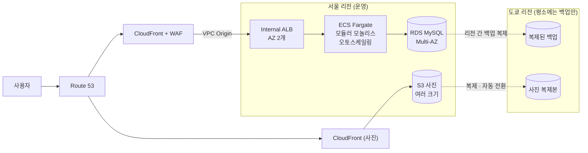
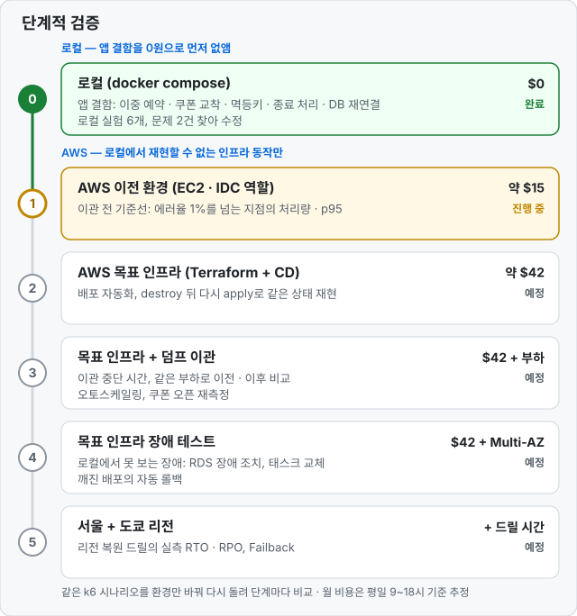

# hotel-booking-aws-v2

소규모 숙박 예약 회사의 IDC(온프레미스) 서비스를 AWS로 이관하는 프로젝트입니다.

4인 팀 프로젝트 [Project_TEAM_AWS](https://github.com/yubin05/Project_TEAM_AWS)(이하 v1)를 회고하고, 같은 고객 문제를 **고객 규모에 맞는 설계**로 다시 풀어 **실측으로 검증**하는 것이 목표입니다.

> **현재 상태: 0단계 완료(앱·CI, 로컬 장애·부하 실험 6개, 비용 추정). 1단계 완료: AWS 이전 환경(웹+앱 · MySQL · NAT EC2 3대)을 Terraform으로 만들고, 부하 기준선은 동시 접속 500명(초당 약 85건)까지 버티고 1,000명에서 무너짐(DB가 먼저 한계, 3회 같음). 1.5단계: 병목을 측정해 앱만 고쳐 같은 서버에서 1,000명 실패율 64% → 1.5%. 2단계 진행 중: 지우지 않는 기반(Terraform state 버킷, 액세스 키 없이 배포하는 GitHub OIDC 역할, 예산 알림)을 코드로 만들었고, 다음은 목표 인프라와 CD.** 측정값이 기록된 항목만 "검증했다"고 표기합니다.

**▶ [새 PC에서 1단계 AWS 이전 환경 올리기](https://github.com/yubin05/hotel-booking-app/blob/main/legacy/README.md)** · 준비물 → 매일 올리기 · 확인 → 지우기를 한 페이지에

## 핵심 내용

- v1 회고 — 실제 문제(트래픽 폭증)와 맞지 않던 멀티클라우드 DR을 Multi-AZ + 오토스케일링 + 리전 간 백업으로 단순화
- 고객 규모에 맞춘 구조 — 마이크로서비스 5개를 모듈러 모놀리스 1개로, API Gateway 없이 CloudFront VPC Origin으로 비공개 ALB에 연결, 최대 태스크 수를 비용 상한으로
- 월 고정 비용 추정 $679 → $205 (−70%) — v1에서 늘 켜 둬야 했던 Azure VPN Gateway · Aurora · DMS 대기 비용을 없앰 (실서비스처럼 상시 운영한다고 보고 AWS · Azure 공식 단가로 계산. 포트폴리오 검증은 작업 시간에만 켜므로 실제 청구서는 이 단가를 검증하는 데 씀)
- 단계적 검증 — 로컬(0원)에서 앱 결함을 먼저 없애고, AWS에서는 로컬에서 재현할 수 없는 인프라 동작만 측정. 같은 k6 시나리오를 환경만 바꿔 다시 돌려 단계마다 비교
- 이관 전 기준선 — 옛날 구조(EC2 t3.micro 3대)는 동시 접속 500명(초당 약 85건)까지 버티고 1,000명에서 무너짐. DB가 먼저 한계(CPU 93%), 3회 모두 같은 결과. 3단계에서 같은 부하로 이관 후와 비교
- 병목을 재고 고치기 — 옛날 구조가 500명에서 무너진 원인을 측정(DB 시간의 60%가 추천 숙소 조회, 1,000명 이후는 서버의 연결 추적 표가 가득 참)하고, 앱만 고쳐 같은 서버에서 1,000명 실패율 64% → 1.5%, 500명 응답 약 6배 빠르게
- 선착순 쿠폰 이벤트 — 1,000명이 100장에 동시에 몰려도 정확히 100장. 함께 느려지던 숙소 조회(p95 813ms)를 발급 전용 DB 연결 분리로 99~237ms까지 줄임

## 왜 다시 만드는가

[v1 팀 프로젝트](https://github.com/yubin05/Project_TEAM_AWS)는 AWS–Azure 멀티클라우드 DR, 마이크로서비스 5개, DMS 실시간 복제처럼 많은 기술을 적용했습니다. 돌아보니 다음 문제가 있었습니다.

- 고객의 실제 문제는 **트래픽 폭증으로 인한 다운**(오토스케일링이 답인 문제)이었는데, 설계는 DR에 집중했습니다.
- 소규모 회사가 감당하기 어려운 **상시 비용과 운영 복잡도**가 생겼습니다.
- 장애 복구와 RTO · RPO를 **정량적으로 검증하지 못했습니다.**

v2는 같은 시나리오를 **요구사항 → 설계 → 실측** 순서로 다시 풉니다. 측정값이 기록된 항목만 "검증했다"고 적습니다. 자세한 내용은 [v1 회고](docs/05-v1-retrospective.md)에 있습니다.

**고객 시나리오**: Sponge Trip은 IDC에서 웹–API–DB 3계층으로 숙박 예약 서비스를 운영하던 소규모 회사입니다. 여행 유튜버의 소개 영상으로 트래픽이 몰리면서 서비스가 약 4시간 중단됐고, MSP인 우리에게 AWS 이관을 의뢰했습니다. → [시나리오와 요구사항](docs/01-scenario.md)

## 목표 아키텍처



| 대비하는 상황 | 방법 |
|---|---|
| 트래픽 폭증 | CloudFront 캐시, ECS 오토스케일링 (최대 태스크 수로 비용 상한) |
| 서버·AZ 장애 | ALB·ECS를 AZ 2개에 분산, RDS Multi-AZ 자동 장애 조치, AZ마다 NAT |
| 데이터 사고 | RDS 시점 복구(PITR) |
| 리전 장애 | 다른 리전에 복제한 백업으로, 같은 Terraform을 써서 복원 (Backup & Restore, 잠정 목표 RTO 1시간). 사진은 CDN이 도쿄 복제본으로 자동 전환 |

→ [아키텍처 상세](docs/02-architecture.md)

## v1과 비교

| 항목 | v1 | v2 |
|---|---|---|
| 백엔드 | 마이크로서비스 5개 (서로 동기 호출) | 모듈러 모놀리스 1개 |
| 컴퓨트 | ECS 5개 서비스, 태스크 10개 | ECS 1개 서비스, 최소 2개 + 오토스케일링 |
| 진입점 | Amplify + API Gateway + VPC Link | CloudFront + WAF + VPC Origin |
| DB | Aurora + DMS CDC로 Azure MySQL 복제 | RDS MySQL Multi-AZ + 리전 간 백업 |
| DR | AWS–Azure Active-Passive | Multi-AZ(HA) + 리전 간 Backup & Restore |
| 이관 | VPN + DMS CDC | 점검 시간 중 덤프·복원 |
| 인증 | Cognito | 앱 자체 JWT |
| 배포 | CodePipeline + CodeDeploy Blue/Green | GitHub Actions + ECS 롤링 + 자동 롤백 |
| 로그 | Firehose + OpenSearch | CloudWatch |
| 이벤트 대응 | 없음 | 선착순 쿠폰(초과 발급 0건) + 예약 스케일링 |
| 검증 | DNS 전환 테스트 위주 | 부하·장애·복원 실측 |
| 월 고정 비용 (추정, 상시) | 약 $679 | 약 $205 ([09 비용 추정](docs/09-cost-estimate.md)) |

## 설계 결정

주요 선택마다 검토한 대안과 근거를 [설계 결정 기록](docs/04-decisions.md)에 남겼습니다.

**아키텍처**

- [AWS로 이관한 이유 (vs SaaS · PaaS 조합)](docs/04-decisions.md#adr-002)
- [ECS Fargate 선택 이유 (vs EKS · EC2)](docs/04-decisions.md#adr-003)
- [모듈러 모놀리스 선택 이유 (vs 마이크로서비스)](docs/04-decisions.md#adr-004)
- [RDS for MySQL Multi-AZ 선택 이유 (vs Aurora)](docs/04-decisions.md#adr-005)
- [CloudFront VPC Origin + Internal ALB 선택 이유 (vs API Gateway)](docs/04-decisions.md#adr-006)
- [숙소 사진을 전용 도메인 CDN으로 분리한 이유 (vs CloudFront 제거 · 한 배포에 경로 규칙)](docs/04-decisions.md#adr-035)
- [출구를 AZ마다 NAT + S3 게이트웨이로 둔 이유 (vs NAT 1개 · VPC 엔드포인트만)](docs/04-decisions.md#adr-034)
- [앱 자체 JWT 선택 이유 (vs Cognito)](docs/04-decisions.md#adr-007)
- [프론트를 앱 컨테이너에 포함한 이유 (vs S3 + OAC)](docs/04-decisions.md#adr-013)
- [선착순 쿠폰을 DB 조건부 갱신으로 처리한 이유 (vs Redis · 대기열)](docs/04-decisions.md#adr-014)

**DR · 이관**

- [멀티클라우드 DR을 쓰지 않는 이유 (vs Azure 대기 · GCP Cold DR)](docs/04-decisions.md#adr-001)
- [Backup & Restore 선택 이유 (vs Pilot Light · Warm Standby)](docs/04-decisions.md#adr-009)
- [리전 전환을 CloudFront 원본 전환으로, 사람이 판단해 하는 이유 (vs DNS 전환 · 자동 전환)](docs/04-decisions.md#adr-012)
- [장애 종류별 복구 목표를 나눈 이유 (AZ 10분 · 리전 1시간, vs Warm Standby)](docs/04-decisions.md#adr-036)
- [덤프로 이관하는 이유 (vs DMS CDC)](docs/04-decisions.md#adr-008)

**배포 · 운영**

- [GitHub Actions 선택 이유 (vs CodePipeline)](docs/04-decisions.md#adr-010)
- [ECR 선택 이유 (vs Docker Hub)](docs/04-decisions.md#adr-020)
- [이미지 태그를 커밋 SHA로 하는 이유 (vs latest)](docs/04-decisions.md#adr-022)
- [스키마 변경을 일회성 ECS 태스크로 하는 이유 (vs 앱 시작 시 적용)](docs/04-decisions.md#adr-031)
- [Terraform 리전별 루트 선택 이유 (vs 변수로 리전 전환)](docs/04-decisions.md#adr-011)
- [예약 스케일링과 목표 추적을 나눠 쓰는 이유](docs/04-decisions.md#adr-015)

**보안 · 권한**

- [평소 최소 권한 + 관리자 역할 전환을 고른 이유 (vs 관리자 그룹)](docs/04-decisions.md#adr-018)
- [GitHub OIDC 선택 이유 (vs 장기 액세스 키)](docs/04-decisions.md#adr-026)
- [ECS 실행 역할을 관리자 루트에서 만드는 이유 (vs 평소 사용자에게 IAM 생성 권한)](docs/04-decisions.md#adr-029)
- [Terraform state를 도쿄 버킷 하나에 두는 이유 (vs 서울 · 리전별 버킷)](docs/04-decisions.md#adr-025)

## 단계적 검증

로컬에서 0원으로 앱 결함을 먼저 없애고, AWS에서는 로컬에서 재현할 수 없는 인프라 동작만 잽니다. 같은 k6 시나리오를 환경만 바꿔 다시 돌려 단계마다 숫자를 비교합니다. 로컬 실험마다 "AWS에서 볼 것"을 적어 두고 해당 단계에서 다시 잽니다(예: E-04 DB 장애 → 4단계 RDS 장애 조치).



단계별 완료 기준은 [진행 계획](docs/03-plan.md)에 있습니다.

## 검증 기록

측정값이 기록된 항목만 "검증했다"고 적고, 응답 시간이 좋아도 데이터가 틀리면 실패로 봅니다. 지금은 1단계(AWS 이전 환경)까지 기록했습니다.

- [이관 전 부하 기준선](docs/experiments/baseline.md) — AWS 이전 환경(EC2 t3.micro 3대)에 손님을 500명씩 늘려 3,000명까지, 3회. 동시 접속 500명(초당 약 85건, p95 1초 이내)까지 버티고 1,000명에서 무너짐(에러율 59~69%). DB가 먼저 한계, 정합성 검사 모두 0
- [DB 병목 분석 · 개선 (1.5단계)](docs/experiments/db-bottleneck.md) — 조회별 DB 시간과 실행 계획으로 원인을 찾아 비싼 조회 2개(추천 숙소 · 검색)를 고치고, 연결 재사용, DB가 오래 걸리는 조회를 직접 끊게, 예약 화면 재시도. 같은 옛날 구조에서 1,000명 실패율 64% → 1.5%. 남은 한계는 DB 서버 CPU
- [로컬 장애 · 부하 실험 6개](docs/07-experiments.md) — 평소 트래픽, 예약 쏠림, 쿠폰 오픈, DB 장애, 서버 강제 종료, 배포 중 종료. 문제 2건을 찾아 고쳤고, 이중 예약 · 예약 유실 · 쿠폰 초과 발급은 모두 0
- [트러블슈팅 9건](docs/troubleshooting/README.md) — 재현 → 원인 → 해결 → 검증 기록 (이중 예약, 쿠폰 교착, DB 연결 고갈, DB 멈춤 등)

## 시나리오 근거

시나리오는 실제 사례를 근거로 잡았습니다. 예를 들어 정부 숙박세일페스타는 야놀자 · 여기어때에서 숙박 할인쿠폰 9만 장을 정해진 시각에 선착순으로 배포했습니다. 이런 "오픈 순간의 쏠림"이 이 프로젝트의 쿠폰 실험 시나리오입니다.

## 앱 저장소와 로컬 실행

앱 코드와 CI/CD는 고객사 앱 저장소 역할의 [yubin05/hotel-booking-app](https://github.com/yubin05/hotel-booking-app)에 있습니다. 이 저장소는 우리(인프라팀)가 만드는 To-Be 인프라와 문서만 둡니다. 배포 역할 · 권한은 이 저장소의 [bootstrap](infra/bootstrap/README.md)이 관리하고, 앱 저장소의 CD는 OIDC로 그 역할을 받습니다([ADR-043](docs/04-decisions.md#adr-043)).

로컬 실행 방법은 앱 저장소 README에 있습니다. 화면 하단 배지는 응답한 서버(로컬·리전·AZ·태스크)를 보여 주며, 장애·리전 전환 시연에 씁니다.

## 비용 원칙

설계는 실운영 기준(RDS Multi-AZ 상시 등)으로 합니다. 포트폴리오 검증은 테스트할 때만 `terraform apply`하고 끝나면 `destroy`합니다. 실제 청구 금액은 단계별로 기록합니다.

월 고정 비용 추정: 상시 운영 기준 v1 약 $679 → v2 약 $205, 작업 시간(평일 9~18시) 기준 v2 약 $55. AWS Budgets 알림은 월 $50으로 1단계 전에 켭니다. → [09 비용 추정](docs/09-cost-estimate.md)

## 문서

| 문서 | 내용 |
|---|---|
| [01 시나리오와 요구사항](docs/01-scenario.md) | 고객 상황, 측정 가능한 요구사항, 가정, 범위 |
| [02 아키텍처](docs/02-architecture.md) | 네트워크·컴퓨트·데이터·보안·CI/CD·DR 흐름·측정 방법 |
| [03 진행 계획](docs/03-plan.md) | 단계별 할 일과 완료 기준, 구현 전 확인 목록 |
| [04 설계 결정 기록](docs/04-decisions.md) | ADR: 무엇을 고르고 무엇을 버렸는지 |
| [05 v1 회고](docs/05-v1-retrospective.md) | v1의 문제와 면접 질문에 대한 v2의 답 |
| [06 용어 정리](docs/06-glossary.md) | 문서에 나오는 용어 풀이 |
| [07 로컬 장애·부하 실험](docs/07-experiments.md) | 실험 목록, 공통 준비, 정합성 검사 (실험별 기록은 [docs/experiments/](docs/experiments/)) |
| [트러블슈팅](docs/troubleshooting/README.md) | 재현 → 원인 → 해결 → 검증 기록 |
| [08 실제 사례 조사](docs/08-real-cases.md) | 시나리오·결정의 근거가 된 실제 기업 사례와 신뢰도 |
| [09 비용 추정](docs/09-cost-estimate.md) | v1·v2 월 고정 비용, 단계별 예상, Budgets 금액 |
| [1단계 이전 환경 올리기](https://github.com/yubin05/hotel-booking-app/blob/main/legacy/README.md) (고객사 저장소) | 새 PC 준비, legacy 권한 붙이기, 매일 apply → 앱 배포 → destroy 명령 |
| [부하 시험](load/README.md) | 이관 전 기준선 · 이관 후 비교를 재는 방법 (인프라팀) |

## 저장소 구조 (예정)

```
infra/
  bootstrap/        Terraform state 버킷, GitHub OIDC 배포 역할, 평소 사용자 정책 (1회 적용)
  global/           Route 53, ACM, CloudFront, WAF
  modules/regional/ VPC, ALB, ECS, RDS, ECR (서울·도쿄 공통)
  seoul/ · tokyo/   리전별 루트: 리전·state 위치를 파일에 고정하고 modules/regional 호출
load/               이관 전후 부하 시험 (baseline.js, 실행기 run-baseline.sh)
scripts/            결과 보고서, 단계 그림, 이관·복원·드릴 스크립트
docs/               설계 문서
```

## 관련 링크

- 고객사 앱 저장소: [yubin05/hotel-booking-app](https://github.com/yubin05/hotel-booking-app)

- v1 저장소: [yubin05/Project_TEAM_AWS](https://github.com/yubin05/Project_TEAM_AWS)
- v1 포트폴리오: [멀티클라우드 DR](https://yubin05-portfolio.vercel.app/projects/multicloud-dr)

호텔 조회·예약 로직과 호텔·객실 시드 데이터는 v1 팀 프로젝트의 코드를 바탕으로 옮겼습니다. 함께한 팀원들의 기여에 감사드립니다.
